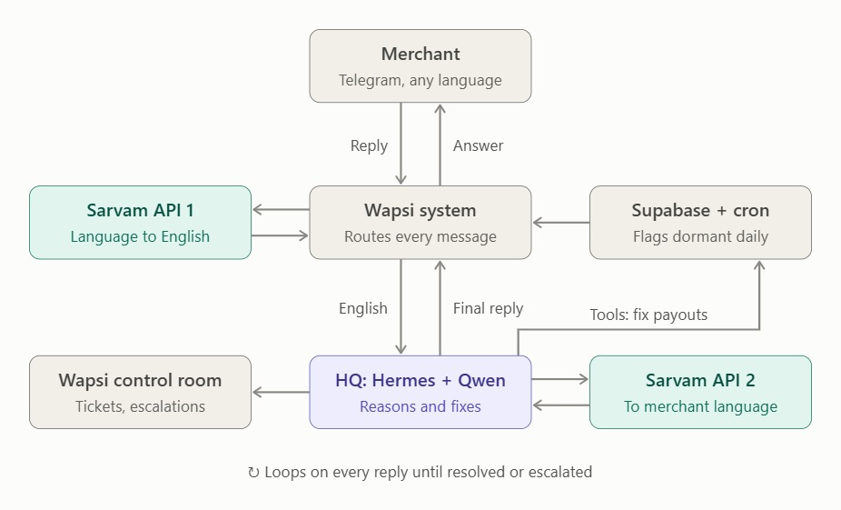

# Bazinga — AI Teammates for Paytm

> **AI teammates that win back inactive merchants & users.**  
> Autonomous agents that find dormant Paytm accounts, resolve what went wrong, and hand off to humans only when needed.

---

## Project Overview

- **Team Name**: Bazinga
- **Team Members**: Utkarsh Bhola, Pranjal Gupta, Purujit Kulshrestha
- **Track**: Track 3 - Autonomous AI Teammates

### The Problem Statement

Build AI teammates that don't just respond; they get the job done

Design an AI teammate that can go beyond answering questions and deliver measurable outcomes in sales or customer service. The AI should understand context, make decisions, take actions, and work alongside human teams.

### Our Solution

We built an autonomous end-to-end agentic workflow:

1. **Detect**: Scheduled daily cron scans identify dormant merchant accounts based on inactivity thresholds.
2. **Reason-Aware Outreach**: Proactively reaches out via messaging channels (Telegram / WhatsApp) tailored to dormancy duration and account history, speaking the merchant's local vernacular language.
3. **Autonomous Resolution**: Rather than merely chatting, agents take action using internal operational tools (re-triggering stuck payouts, querying settlement status, unblocking workflows).
4. **Human Handoff & Escalation**: Complex edge cases, sensitive money disputes, or human requests are routed to Paytm internal teams on Slack with full context dossiers.
5. **Ops Control Room**: A Next.js control center displaying live resolution stats, volume at risk vs. recovered, root-cause breakdowns, and merchant ticket audits.

### System Flow & Architecture



_The workflow loops on incoming replies: translating vernacular messages via Sarvam AI, reasoning and executing tool fixes with Hermes & Qwen, updating the control room, and responding back to the merchant in their native language._

---

## Repository Structure

```text
bazinga-paytm-hackathon/
├── client/     # Next.js 16 (App Router) Operations Control Room Dashboard
└── server/     # Node.js & TypeScript layered backend (APIs, Agent, Telegram, Slack, Translation)
```

---

## Quickstart: How to Run

### Prerequisites

- Node.js (v20+ recommended)
- npm or pnpm

---

### 1. Server Setup (`server/`)

1. Open a terminal and enter the server directory:

   ```bash
   cd server
   ```

2. Install dependencies:

   ```bash
   npm install
   ```

3. Configure environment variables in `server/.env` (refer to `server/.env.example`):

   ```env
   PORT=5000
   TELEGRAM_BOT_TOKEN=your_bot_token_here
   TELEGRAM_DEFAULT_CHAT_ID=your_chat_id_here
   SARVAM_API_KEY=your_sarvam_key_here
   SLACK_WEBHOOK_URL=your_slack_webhook_here
   ```

4. Start the server in development mode:
   ```bash
   npm run dev
   ```
   _The server runs on [http://localhost:5000](http://localhost:5000) (Health check: `/health`)._

---

### 2. Client Setup (`client/`)

1. Open a second terminal and enter the client directory:

   ```bash
   cd client
   ```

2. Install dependencies:

   ```bash
   npm install
   ```

3. Configure environment variables in `client/.env` (refer to `client/.env.example`):

   ```env
   NEXT_PUBLIC_SERVER_URL=http://localhost:5000
   ```

4. Start the Next.js development server:
   ```bash
   npm run dev
   ```
   _Open [http://localhost:3000](http://localhost:3000) in your browser to access the control room dashboard._

---

## Documentation Links

- For frontend details and UI components, see [`client/README.md`](client/README.md).
- For backend layers, API routes, and webhook setups, see [`server/README.md`](server/README.md).
